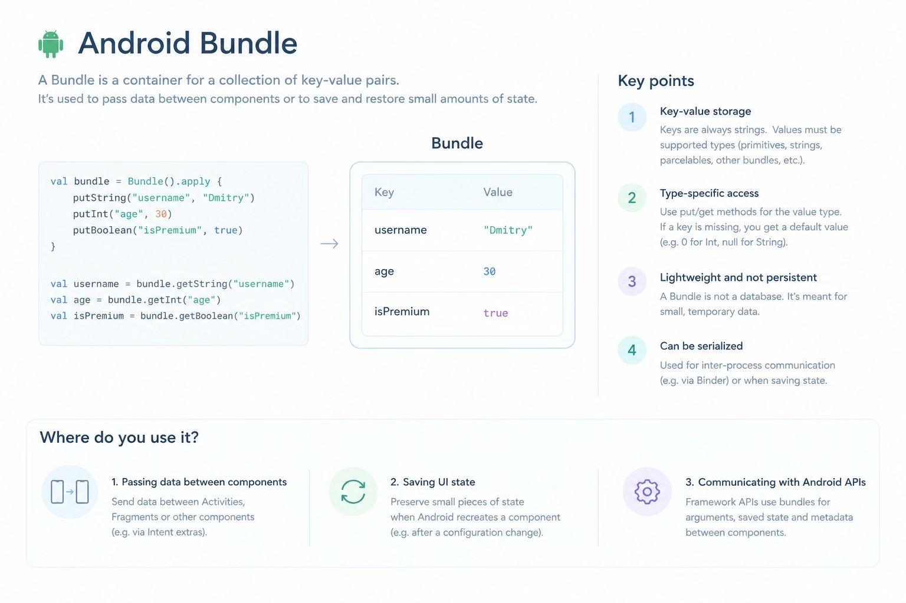

A Bundle is a container for a collection of key-value pairs passed between Android components or for preserving small amounts of state.

key - string.
value - must be supported types, such as primitives, strings, parcelables, or other bundles.

Where to use.
A. Passing data between screens
Send an item ID or other small piece of data from one Activity or Fragment to another.
B. Saving UI state
Preserve small pieces of state when Android recreates an Activity, for example after a configuration change or process recreation.
C. Communicating with Android APIs
Android framework APIs use bundles for arguments, saved state, and metadata passed between components.

In a modern Compose application, you may rarely construct a Bundle manually for ordinary screen state.

A Bundle is a transport and restoration container, not a database, not a screen architecture, and not a lifecycle owner.

When deciding whether to use one.
Passing a small piece of data to another component? Use an Intent extra or navigation argument.

Restoring small UI state after recreation? Use saved-state APIs such as SavedStateHandle or rememberSaveable.

Retaining screen state during configuration changes? Use a ViewModel.

Storing data beyond the current UI lifecycle? Use persistent storage such as DataStore or Room.
