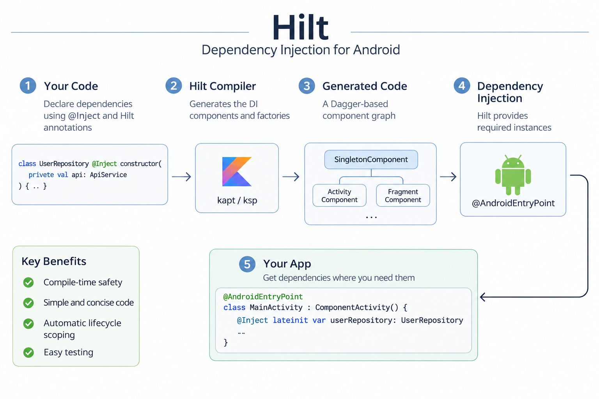

# Android Hilt (Jetpack Dependency Injection)
Hilt is an opinionated, compile-time dependency injection framework built on top of Dagger that standardizes dependency provisioning, scoping, and lifecycle management across standard Android framework classes.       
### Why It Matters.    
Compile-Time Graph Verification: Missing bindings, circular dependencies, and invalid scope references fail at build time via KSP/kapt rather than crashing at runtime (unlike reflection-based or service-locator approaches).Zero-Boilerplate Component Wiring: Eliminates manual Dagger @Component declarations, @Subcomponent builders, and custom Application container graphs.Lifecycle-Aligned Memory Safety: Automatically creates and destroys dependency containers in lockstep with Android framework lifecycles (Application, Activity, ViewModel, Fragment, View, Service), preventing memory leaks caused by long-lived objects holding short-lived Context references.First-Class Testing Support: Replaces production modules in unit and instrumentation tests via @TestInstallIn and @UninstallModules without altering production source code.     
### Under the Hood.   
Annotation Processing & Bytecode Transformation (Compile Time)Annotating your Application class with @HiltAndroidApp triggers Hilt's annotation processor to generate a base class (Hilt_<AppName>) that instantiates and owns the root SingletonComponent.Annotating Android classes (Activity, Fragment, View, Service, BroadcastReceiver) with @AndroidEntryPoint generates a corresponding superclass (Hilt_<ClassName>) containing lifecycle hooks that request injection.The Hilt Gradle plugin runs an ASM bytecode transformation pass so your classes inherit from the generated Hilt_* superclasses automatically without requiring manual inheritance changes in Kotlin or Java source files.Predefined Component Hierarchy GenerationHilt generates a fixed tree of Dagger components and subcomponents tied to Android lifecycles.Child components inherit all bindings from their ancestor components (FragmentComponent can inject bindings from ActivityComponent, ActivityRetainedComponent, and SingletonComponent), whereas parent components cannot access child bindings.Global Module Discovery & Aggregation (@InstallIn)Every @Module must carry @InstallIn(<TargetComponent>::class).During compilation, Hilt emits metadata classes into a shared internal package (hilt_aggregated_deps). At application link time, Hilt's aggregating task scans the classpath across all Gradle modules and wires every @InstallIn module into its target component automatically.Instance Caching & Scoping (DoubleCheck)Unscoped @Inject constructors or @Provides methods instantiate a fresh object on every injection request.Scoped bindings (@Singleton, @ActivityRetainedScoped, @ViewModelScoped, @ActivityScoped, @FragmentScoped, @ViewScoped, @ServiceScoped) wrap the generated Dagger Provider<T> in DoubleCheck.provider(...) inside that specific component instance, ensuring thread-safe single-instance reuse for that component's lifespan.Runtime Injection ExecutionProcess Start: Hilt_<AppName>.onCreate() initializes Dagger<App>_HiltComponents_SingletonC.Configuration Change Survival: ActivityRetainedComponent is stored inside an internal AndroidX ViewModel attached to the Activity's ViewModelStore. When an Activity rotates, ActivityComponent is destroyed and recreated, while ActivityRetainedComponent persists.Entry-Point Injection: Inside Hilt_<Activity>.onCreate(), super.onCreate() obtains the ActivityComponent, calls injectActivity(this), and populates @Inject fields before your onCreate() body executes.ViewModel Creation: @HiltViewModel generates a ViewModel metadata entry consumed by HiltViewModelFactory (injected into getDefaultViewModelProviderFactory()), supplying SavedStateHandle and constructor dependencies from ViewModelComponent.      

```Kotlin
@HiltAndroidApp
class CommerceApp : Application()

// 2. Domain Interface & Implementation
interface OrderRepository {
    suspend fun fetchOrder(id: String): Order
}

class NetworkOrderRepository @Inject constructor(
    private val api: OrderApi,
    @IoDispatcher private val dispatcher: CoroutineDispatcher
) : OrderRepository {
    override suspend fun fetchOrder(id: String): Order = withContext(dispatcher) {
        api.getOrderById(id)
    }
}

// 3. Hilt Modules (Binding Interfaces & External Instances)
@Qualifier
@Retention(AnnotationRetention.BINARY)
annotation class IoDispatcher

@Module
@InstallIn(SingletonComponent::class)
abstract class RepositoryModule {
    @Binds
    @Singleton
    abstract fun bindOrderRepository(impl: NetworkOrderRepository): OrderRepository
}

@Module
@InstallIn(SingletonComponent::class)
object NetworkModule {
    @Provides
    @Singleton
    fun provideOrderApi(): OrderApi = Retrofit.Builder()
        .baseUrl("https://api.example.com/")
        .build()
        .create(OrderApi::class.java)

    @Provides
    @IoDispatcher
    fun provideIoDispatcher(): CoroutineDispatcher = Dispatchers.IO
}

// 4. ViewModel with Constructor Injection & SavedStateHandle
@HiltViewModel
class OrderViewModel @Inject constructor(
    private val repository: OrderRepository,
    savedStateHandle: SavedStateHandle
) : ViewModel() {
    private val orderId: String = checkNotNull(savedStateHandle["orderId"])
    val uiState: StateFlow<Order?> = flow { emit(repository.fetchOrder(orderId)) }
        .stateIn(viewModelScope, SharingStarted.WhileSubscribed(5_000), null)
}

// 5. Activity Entry Point
@AndroidEntryPoint
class OrderActivity : ComponentActivity() {
    private val viewModel: OrderViewModel by viewModels()

    override fun onCreate(savedInstanceState: Bundle?) {
        super.onCreate(savedInstanceState)
        // viewModel is automatically provided by HiltViewModelFactory
    }
}
```

Trade-offs and PitfallsIncremental Build Overhead:
- Hilt's classpath aggregation step (hiltAggregateDeps) and annotation processing add build latency in large multi-module repositories. 
- Mitigation: migrate from kapt to KSP (com.google.devtools.ksp) and isolate @AndroidEntryPoint usage to thin UI modules.
- Transitive Visibility in Multi-Module Builds: 
Every @InstallIn module must be visible to the app module at compile time. Exposing internal implementation classes via @Provides breaks compilation; expose public interfaces via @Binds instead.
- Scope Misuse & Memory Leaks: Overusing @Singleton retains memory for the entire process lifetime. Conversely, scoping state to @ActivityScoped instead of @ActivityRetainedScoped or @ViewModelScoped wipes state on rotation. Never inject @ActivityContext into a @Singleton or @ViewModelScoped object.
- Hierarchy Propagation Requirement: Annotating a Fragment or View with @AndroidEntryPoint requires its host Activity (and any parent Fragment) to also carry @AndroidEntryPoint; omitting it throws a runtime IllegalStateException.
- Fixed Component Tree: You cannot insert custom intermediate scopes (such as an authenticated user session scope) directly into Hilt's built-in tree; custom session lifecycles require managing a state holder or manual Dagger subcomponent inside SingletonComponent.      

Question:"How does Hilt improve upon plain Dagger 2 on Android, and how does it keep dependencies alive across configuration changes?     
Answer:"Hilt is built directly on Dagger 2, so it preserves compile-time dependency graph validation and zero runtime reflection, while removing the boilerplate of manually writing components, subcomponents, and custom Application injectors. It achieves this through a standardized component hierarchy aligned with Android lifecycles, global module auto-discovery via @InstallIn, and Gradle bytecode transformation that automatically wires generated Hilt_* base classes into @AndroidEntryPoint components. To handle configuration changes like screen rotation, Hilt separates ActivityComponent from ActivityRetainedComponent. While ActivityComponent is destroyed and recreated with the Activity instance, ActivityRetainedComponent is stored inside an internal AndroidX ViewModel backed by the Activity's ViewModelStore. Because ViewModelStore survives configuration changes, any @ActivityRetainedScoped dependencies and @HiltViewModel instances persist seamlessly across rotations and are only cleared when the Activity finishes permanently."

