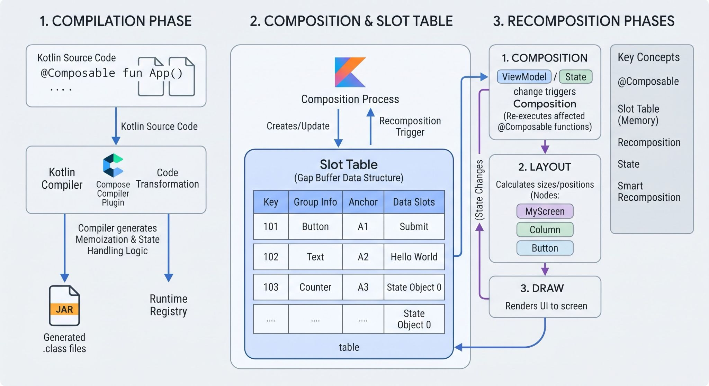

# Understanding Kotlin @Composable
The @Composable annotation is a specialized compiler directive in Jetpack Compose that signals to the Compose compiler plugin that a function is intended to transform data into a reactive, declarative UI hierarchy.

Before Jetpack Compose, Android UI development was strictly imperative: developers had to manually instantiate views (findViewById), maintain state across fragments/activities, and call mutating methods like setVisibility() or setText() whenever data changed. This approach often led to UI bugs, complex synchronization logic, and massive view hierarchies.         
@Composable fundamentally transforms this paradigm by enabling declarative UI:
- Single Source of Truth: Your UI describes what it should look like for a given state at any moment, rather than how to transition between states.
- Reactive Recomposition: The framework automatically tracks state changes and intelligently re-invokes only the affected composable functions.
- Drastic Boilerplate Reduction: Complex custom views that once required hundreds of lines of XML and custom View subclassing are now written in concise, readable Kotlin functions.

### Under the Hood
When you annotate a function with @Composable, magic happens during compilation and execution:       
1. The Compose Compiler Plugin        
Standard Kotlin bytecode cannot inherently track UI hierarchy or state reads. During compilation, the Compose Compiler plugin intercepts your @Composable functions:
It injects a hidden Composer parameter into the function signature.
It transforms the function body, wrapping state reads so the runtime knows which UI elements depend on which state variables.
It inserts tracking calls that register the function's position in the execution tree.
2. The Slot Table       
Compose doesn't use a traditional DOM or standard Android View tree. Instead, it generates a linear memory data structure called the Slot Table.
Every @Composable call writes its data, state, and child nodes into this flat array-backed table.
During recomposition, the slot table allows the runtime to skip unchanged branches instantly without re-executing entire UI subtrees.
3. The Three Phases of Compose        
Every frame rendered by Jetpack Compose goes through three distinct phases:
Composition: Executes @Composable functions to build/update the description of your UI tree.
Layout: Measures and positions every element in 2D space.
Drawing: Renders the elements onto the device canvas.
4. Example — Real Code       
Here is a clean, idiomatic example of a stateful @Composable function:
```Kotlin
import androidx.compose.foundation.layout.*
import androidx.compose.material3.*
import androidx.compose.runtime.*
import androidx.compose.ui.Alignment
import androidx.compose.ui.Modifier
import androidx.compose.ui.unit.dp

@Composable
fun CounterCard() {
    // State holding the current count value
    var count by remember { mutableStateOf(0) }

    Surface(
        modifier = Modifier.padding(16.dp),
        shadowElevation = 4.dp
    ) {
        Column(
            modifier = Modifier.padding(16.dp),
            horizontalAlignment = Alignment.CenterHorizontally
        ) {
            Text(text = "Current Count: $count", style = MaterialTheme.typography.titleLarge)
            Spacer(modifier = Modifier.height(8.dp))
            Button(onClick = { count++ }) {
                Text("Increment")
            }
        }
    }
}
```

### Trade-offs and Pitfalls
While @Composable makes UI development delightful, developers often run into a few common pitfalls:
Frequent Recompositions & Performance: If state is read too high up in the composable tree (e.g., at the root level), an entire screen might recompose when only a tiny text label changes. Solution: Defer state reads as deep down the tree as possible.
Unstable Types: The Compose compiler attempts to skip recomposition if input parameters haven't changed. If your parameters use mutable collections or classes that aren't marked as stable (or immutable), Compose assumes they changed and forces a recomposition.
Side Effects in Composition: Composable functions can execute frequently and out of order (due to concurrent recomposition or animations). Performing network requests, database writes, or mutating global variables directly inside a @Composable body will lead to unpredictable bugs. Use effect handlers like LaunchedEffect or rememberCoroutineScope instead.

[Jetpack Compose vs SwiftUI]()

### Interview Answer
Likely Question
"What does the @Composable annotation do under the hood, and how does Jetpack Compose optimize recomposition?"

60-Second Answer
"The @Composable annotation is a compiler directive processed by the Compose compiler plugin. It rewrites function signatures to inject a hidden Composer parameter and transforms the function body to track state reads.

Under the hood, Compose builds a linear data structure called the Slot Table rather than a traditional view hierarchy. When state changes, the runtime triggers recomposition, comparing current inputs against previous values. If a composable function's inputs are stable and unchanged, Compose automatically skips executing that function and its children, resulting in highly efficient UI updates."
