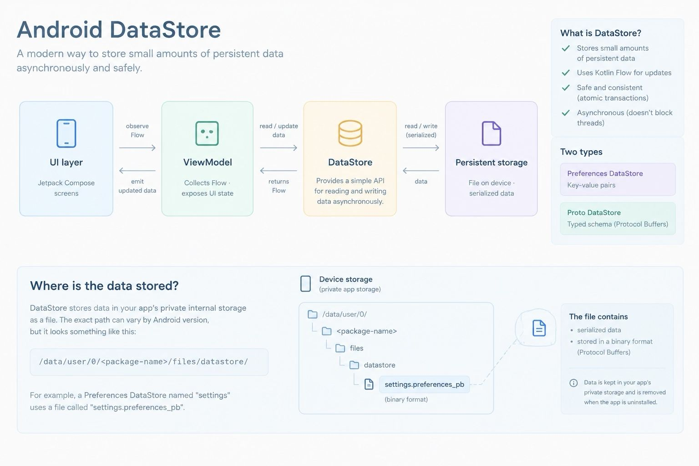

DataStore is an Android Jetpack library for storing small amounts of persistent application data asynchronously and safely. It is commonly used for user preferences, application settings, and small pieces of state that must survive process restarts.

It operates locally on the device and manages persistence behind a Kotlin API.
The application typically interacts with DataStore using asynchronous operations instead of directly reading and writing a file.

DataStore stores data in app's private internal storage.
The exact path can vary by Android storage conventions and configuration.

Preferences DataStore is usually the simplest choice for app settings. Proto DataStore is useful when the data has a defined structure and you want stronger guarantees about its shape.
Neither is intended to replace Room for relational data, complex queries, or large collections of application records.
