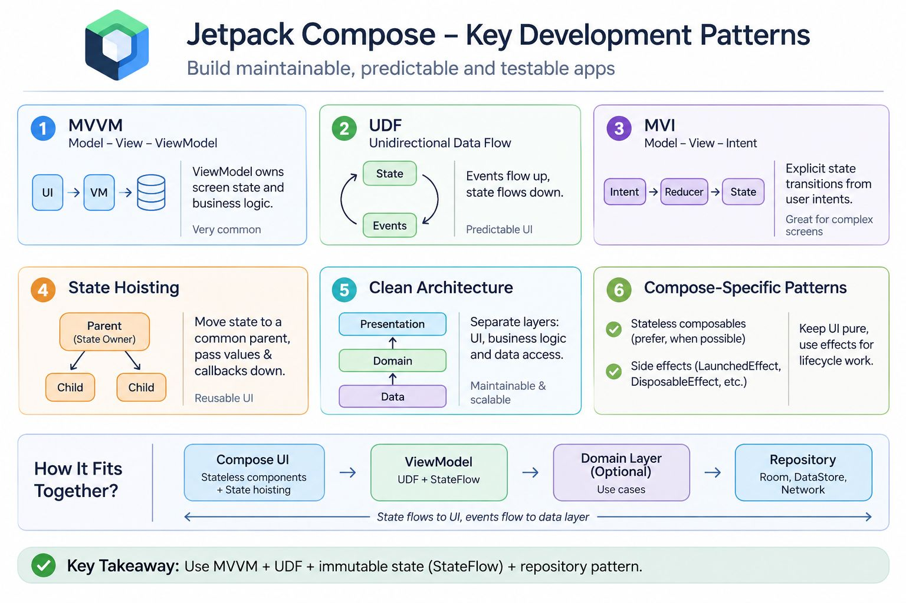

1. MVVM — Model–View–ViewModel
The ViewModel owns screen-level state and business presentation logic. Compose observes that state and renders the UI.
Typical flow: Compose UI → ViewModel → Repository → Data source
Best for: most standard Android applications.

2. UDF — Unidirectional Data Flow
UI events flow upward; state flows downward. For example, a button click becomes an event handled by the ViewModel, which updates the state observed by Compose.

Best for: predictable UI updates, testability, and reducing state inconsistencies.
UDF is a data-flow principle, not a competing architecture to MVVM.
3. MVI — Model–View–Intent
A more explicitly state-driven approach. User intents or events are processed into a new, usually immutable UI state, often through a reducer.
Best for: complex screens, workflows, filtering, forms, and screens with many interacting states.
MVI is often implemented using Kotlin StateFlow, sealed interfaces, and immutable data classes.

4. State hoisting
State is moved to a common parent or state owner. Child composables receive values and callbacks instead of owning shared state independently.
Best for: reusable composables, dialogs, input fields, and lists.

5. Clean Architecture / layered architecture
Separates presentation, domain logic, and data access. Repositories abstract data sources; use cases encapsulate domain operations when useful.
Best for: larger applications, multiple data sources, complex business rules, and maintainability.

MVVM defines responsibility; UDF defines the direction of state and events; MVI usually adds a more explicit event-to-state transition model. They are not three mutually exclusive choices.
