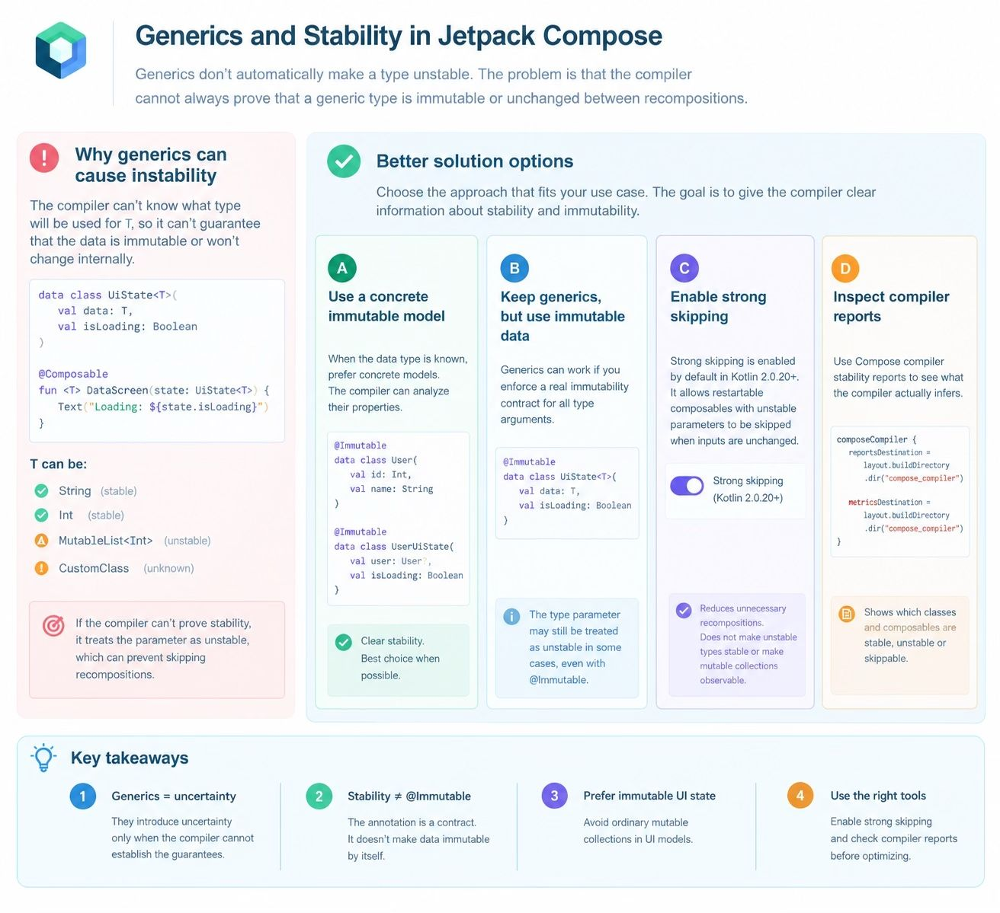

## GENERICS
Generic types can cause stability problems because the Compose compiler may not be able to prove that a generic object's data is immutable or that its properties remain unchanged between recompositions.
The important distinction is that generics do not automatically make a type unstable. The problem is often that the compiler cannot determine the stability of the generic type parameter.

Compose uses stability information to decide whether a composable can be skipped during recomposition. If a parameter is unstable, Compose generally cannot rely on equality checks in the same way it can for stable parameters.
This does not mean the entire UI must recompose every time. Compose still uses its dependency tracking, and other optimization rules can apply.

Solutions.
Option A: Use a concrete immutable model
When the data type is known, this is usually the simplest solution.

Option B: Keep generics, but use immutable data.

Option C: Enable strong skipping.
