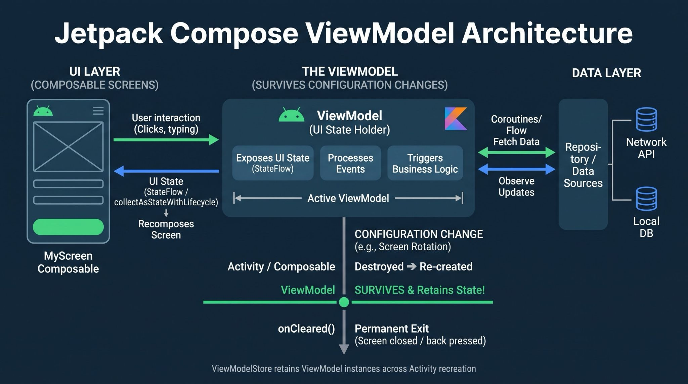

# Compose ViewModel
A lifecycle-aware architectural component that acts as a bridge between your data/business layers and your Compose UI, designed specifically to retain, manage, and expose UI State while surviving configuration changes (like screen rotation).        

Before ViewModels, anytime an Android device underwent a configuration change (such as rotating the screen, changing themes, or resizing a split-screen), the hosting Activity or Fragment would be completely destroyed and recreated. Without manually serializing, any unsaved UI data (typed text, loading states, API response data) would be lost.In Jetpack Compose, state is everything. Re-fetching data or losing UI state because the screen rotated disrupts the user experience and wastes resources. The ViewModel matters because:Survivability: It stays alive in memory across Activity destruction/recreation, guaranteeing your state remains intact.Separation of Concerns: It moves complex state logic, validation, async requests, and event handling out of visual Composable functions, keeping the UI declarative and "dumb."Memory Management: It automates the lifecycle of background operations, preventing memory leaks when navigating away by cancelling coroutine jobs inside the VM’s scope.          

### Under the Hood
How does the ViewModel persist when the Activity that created it dies?
- The ViewModelStoreOwner: Any host (usually an Activity, Fragment, or Navigation backstack entry) implements ViewModelStoreOwner. This owner holds onto a ViewModelStore, which is essentially a HashMap<String, ViewModel> stored in memory.
- Retaining Across Configuration Changes: When a configuration change happens, the system destroys the Activity, but its ViewModelStore is retained by the Android OS using a non-configuration instance mechanism (NonConfigurationInstances).
- Re-binding on Recreation: After the rotation, when the Activity is recreated, it receives the exact same ViewModelStore instance.
- Resolution via Provider: When Compose requests the VM using viewModel() or hiltViewModel(), it checks this retained ViewModelStore first. It finds the already existing instance and reconnects it, skipping a brand-new instantiation.
- Observation with Flow: ViewModels hold observable state wrappers—ideally StateFlow or MutableState. Compose screens observe (or "collect") this Flow using lifecycle-aware APIs like collectAsStateWithLifecycle(). Whenever the ViewModel updates this StateFlow, Compose is notified to "recompose" (redraw) the screen with new values.
- Destruction & onCleared(): If the host is permanently destroyed (e.g., the user presses the back button or finishes the task), the ViewModelStoreOwner clears the store. It triggers onCleared() inside the ViewModel, which cancels the viewModelScope and tears down any active resources.       


```Kotlin
class UserUiState(
    val username: String = "",
    val isLoading: Boolean = false,
    val errorMessage: String? = null
)
```

```Kotlin
import androidx.lifecycle.viewModelScope
import kotlinx.coroutines.delay
import kotlinx.coroutines.flow.MutableStateFlow
import kotlinx.coroutines.flow.StateFlow
import kotlinx.coroutines.flow.asStateFlow
import kotlinx.coroutines.flow.update
import kotlinx.coroutines.launch

class UserViewModel : ViewModel() {

    // 1. Encapsulate State (ReadOnly externally)
    private val _uiState = MutableStateFlow(UserUiState())
    val uiState: StateFlow<UserUiState> = _uiState.asStateFlow()

    fun loadUserData() {
        viewModelScope.launch {
            _uiState.update { it.copy(isLoading = true) }
            try {
                // Simulate network call
                delay(1500) 
                _uiState.update { 
                    it.copy(username = "DevAndroid", isLoading = false) 
                }
            } catch (e: Exception) {
                _uiState.update { 
                    it.copy(errorMessage = "Failed to load data", isLoading = false) 
                }
            }
        }
    }
}
```

```Kotlin
import androidx.compose.material3.*
import androidx.compose.runtime.Composable
import androidx.compose.runtime.getValue
import androidx.lifecycle.compose.collectAsStateWithLifecycle
import androidx.lifecycle.viewmodel.compose.viewModel

@Composable
fun UserProfileScreen(
    // Inject the ViewModel
    viewModel: UserViewModel = viewModel() 
) {
    // 2. Safely collect state aware of Compose lifecycle
    val state by viewModel.uiState.collectAsStateWithLifecycle()

    Box(modifier = Modifier.fillMaxSize(), contentAlignment = Alignment.Center) {
        when {
            state.isLoading -> CircularProgressIndicator()
            state.errorMessage != null -> Text("Error: ${state.errorMessage}")
            state.username.isNotEmpty() -> {
                Column(horizontalAlignment = Alignment.CenterHorizontally) {
                    Text("Welcome back, ${state.username}!")
                }
            }
            else -> {
                Button(onClick = { viewModel.loadUserData() }) {
                    Text("Load User Data")
                }
            }
        }
    }
}
```



6. Trade-offs and PitfallsWhile highly beneficial, misuse of ViewModels can introduce bugs.
- State hoarding (Monolithic ViewModels): Cramming all logic, navigation, and visual behaviors into a single giant ViewModel. Keep ViewModel logic scoped specifically to UI-data transformations.
- Memory leaks: Passing Android UI-related objects (like Context, View, or Compose State instances) into the ViewModel. Doing so can cause leaks if the Composable is disposed of while the ViewModel survives. Refer to AndroidViewModel or access Resources carefully.
-  Relying on ViewModels for every piece of state: Short-lived, localized UI state (like a collapsed/expanded card or focused state) belongs directly in Composable state using remember { mutableStateOf(...) }, not in the ViewModel.
- Process Death: The ViewModel survives configuration changes, but not process death (where Android kills an background app to free up RAM). For important user state, pair the ViewModel with SavedStateHandle.          

7. Interview AnswerLikely Interview Question: "Can you explain the purpose of a Jetpack Compose ViewModel and how it manages to survive configuration changes?"        
Answer:"In Jetpack Compose, a ViewModel is a lifecycle-aware state holder designed to store UI-related data and manage the business logic for your screen. Its primary purpose is to decouple your declarative UI from your data sources and maintain UI state across configuration changes, like screen rotation, without losing progress.Under the hood, it survives destruction because it's managed by a ViewModelStoreOwner—typically the Activity, Fragment, or Navigation Host. When a configuration change occurs, the host destroys the visual Activity but keeps the associated ViewModelStore in the memory using Android’s retain configuration instance mechanism.When the host screen is recreated, it connects right back to the original ViewModelStore, extracting the existing ViewModel instance instead of creating a new one. Once the screen is permanently exited (such as popping the back stack or finishing the screen), the ViewModelStore gets cleared, invoking the ViewModel's onCleared() method where coroutine scopes are safely cancelled to prevent memory leaks."