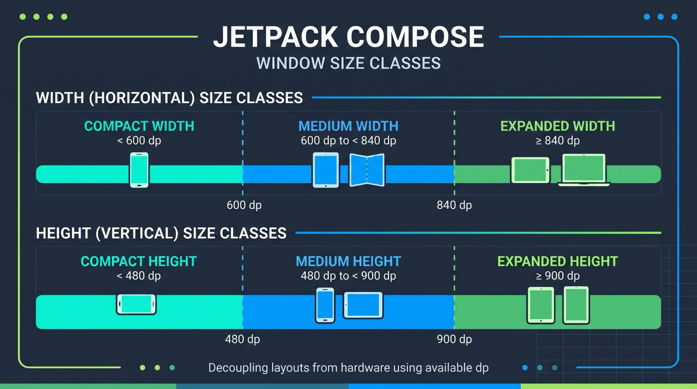

# Jetpack Compose Window Size Classes
Window Size Classes are a set of opinionated viewport width and height breakpoints (Compact, Medium, Expanded, plus opt-in Large and Extra-large) that map an app's current window dimensions in density-independent pixels (dp) to discrete layout buckets so UI structures adapt dynamically to available screen space rather than physical device hardware.   

--- 

Decouples layout from hardware identity: Checking isTablet or Configuration.orientation fails in split-screen multi-window, ChromeOS/Android desktop freeform windows, and foldables. A tablet running in 50/50 split-screen has a Compact window width despite running on tablet hardware.   
Android Developers
Prevents stretched or clipped interfaces: Expanding a single-column phone layout across an 840 dp+ viewport destroys text line-length readability and wastes screen real estate; compressing a multi-pane desktop layout into a 360 dp window clips controls.
Standardizes canonical layout transitions: Establishes deterministic thresholds for swapping navigation chrome (NavigationBar to NavigationRail to permanent NavigationDrawer) and content topology (single-pane to ListDetailPaneScaffold or SupportingPaneScaffold).   
Bounds design and QA matrixes: Collapses thousands of distinct Android screen resolutions into a finite set of width and height test configurations.

### Under the Hood
OS Window Bounds Extraction (WindowMetricsCalculator):
Jetpack WindowManager's WindowMetricsCalculator.getOrCreate().computeCurrentWindowMetrics(context) queries the platform WindowManager (WindowMetrics.getBounds() on API 30+, or Display bounds adjusted for system decorations on older APIs) to retrieve the exact pixel Rect assigned to the app window—ignoring physical screen dimensions outside the window.   

Configuration & Posture Observation:
- In Compose, currentWindowAdaptiveInfo() (from androidx.compose.material3.adaptive) reads LocalConfiguration.current, LocalContext.current, and window fold features via WindowInfoTracker. Whenever the window resizes—via device rotation, split-screen divider drag, foldable hinge state transition, or desktop window resizing—LocalConfiguration updates and invalidates the reading composable scope.
Pixel-to-DP Normalization:
Raw window dimensions in physical pixels (px) are divided by logical display density (LocalDensity.current.density / displayMetrics.density):
widthDp = bounds.width() density,
heightDp = bounds.height() density
widthDp= density bounds.width(),
heightDp= density bounds.height() ​	
 
- Breakpoint Classification (computeWindowSizeClass):
androidx.window.core.layout.WindowSizeClass compares widthDp and heightDp against lower-bound breakpoint sets (BREAKPOINTS_V1 by default, or BREAKPOINTS_V2 when supportLargeAndXLargeWidth = true):

- Width breakpoints:
Compact: less than 600 dp (portrait phones)   
Medium: 600 dp to less than 840 dp (portrait tablets, unfolded inner screens in portrait)   
Expanded: 840 dp to less than 1200 dp (landscape tablets, unfolded inner screens in landscape)   
Large (opt-in V2): 1200 dp to less than 1600 dp (large tablets)
Extra-large (opt-in V2): at least 1600 dp (desktop/external displays)

- Height breakpoints:
Compact: less than 480 dp (landscape phones)   
Medium: 480 dp to less than 900 dp (portrait phones, landscape tablets)   
Expanded: at least 900 dp (portrait tablets)   

- State Hoisting & Targeted Recomposition:
The resulting immutable WindowSizeClass is evaluated near the root composable and converted into boolean layout decisions (isWidthAtLeastBreakpoint(...)). Only the structural container branch recomposes across threshold crossings, while child state stored in rememberSaveable or a ViewModel remains intact.



```Kotlin
import androidx.compose.foundation.layout.*
import androidx.compose.material.icons.Icons
import androidx.compose.material.icons.filled.Email
import androidx.compose.material.icons.filled.Settings
import androidx.compose.material3.*
import androidx.compose.material3.adaptive.currentWindowAdaptiveInfo
import androidx.compose.material3.adaptive.navigationsuite.NavigationSuiteScaffold
import androidx.compose.runtime.*
import androidx.compose.runtime.saveable.rememberSaveable
import androidx.compose.ui.Modifier
import androidx.compose.ui.unit.dp
import androidx.window.core.layout.WindowSizeClass

@Composable
fun AdaptiveMailApp(
    // Default at root; injectable for Compose Previews and UI tests
    windowSizeClass: WindowSizeClass = currentWindowAdaptiveInfo(
        supportLargeAndXLargeWidth = true
    ).windowSizeClass
) {
    var selectedTab by rememberSaveable { mutableIntStateOf(0) }
    var selectedMessageId by rememberSaveable { mutableStateOf<String?>(null) }

    // Evaluate structural thresholds once at the root
    val isExpandedWidth = windowSizeClass.isWidthAtLeastBreakpoint(
        WindowSizeClass.WIDTH_DP_EXPANDED_LOWER_BOUND // 840 dp
    )
    val isNotCompactHeight = windowSizeClass.isHeightAtLeastBreakpoint(
        WindowSizeClass.HEIGHT_DP_MEDIUM_LOWER_BOUND // 480 dp
    )
    val showTwoPane = isExpandedWidth && isNotCompactHeight

    // Automatically switches NavigationBar (Compact) -> NavigationRail (Medium/Expanded)
    NavigationSuiteScaffold(
        navigationSuiteItems = {
            item(
                icon = { Icon(Icons.Default.Email, contentDescription = "Inbox") },
                label = { Text("Inbox") },
                selected = selectedTab == 0,
                onClick = { selectedTab = 0 }
            )
            item(
                icon = { Icon(Icons.Default.Settings, contentDescription = "Settings") },
                label = { Text("Settings") },
                selected = selectedTab == 1,
                onClick = { selectedTab = 1 }
            )
        }
    ) {
        if (showTwoPane) {
            Row(modifier = Modifier.fillMaxSize()) {
                MessageListPane(
                    selectedId = selectedMessageId,
                    onSelectMessage = { selectedMessageId = it },
                    modifier = Modifier.weight(0.4f).fillMaxHeight()
                )
                VerticalDivider()
                MessageDetailPane(
                    messageId = selectedMessageId,
                    onBack = null, // Simultaneous visibility removes need for back navigation
                    modifier = Modifier.weight(0.6f).fillMaxHeight()
                )
            }
        } else {
            // Single-pane navigation for Compact/Medium widths or short landscape viewports
            val activeId = selectedMessageId
            if (activeId == null) {
                MessageListPane(
                    selectedId = null,
                    onSelectMessage = { selectedMessageId = it },
                    modifier = Modifier.fillMaxSize()
                )
            } else {
                MessageDetailPane(
                    messageId = activeId,
                    onBack = { selectedMessageId = null },
                    modifier = Modifier.fillMaxSize()
                )
            }
        }
    }
}

@Composable
private fun MessageListPane(
    selectedId: String?,
    onSelectMessage: (String) -> Unit,
    modifier: Modifier = Modifier
) {
    Surface(modifier = modifier) {
        Column(modifier = Modifier.padding(16.dp)) {
            Text("Inbox", style = MaterialTheme.typography.titleLarge)
            Spacer(Modifier.height(12.dp))
            listOf("msg_1", "msg_2").forEach { id ->
                FilterChip(
                    selected = selectedId == id,
                    onClick = { onSelectMessage(id) },
                    label = { Text("Message $id") }
                )
            }
        }
    }
}

@Composable
private fun MessageDetailPane(
    messageId: String?,
    onBack: (() -> Unit)?,
    modifier: Modifier = Modifier
) {
    Surface(modifier = modifier) {
        Column(modifier = Modifier.padding(16.dp)) {
            if (onBack != null) {
                TextButton(onClick = onBack) { Text("Back") }
            }
            Text(
                text = messageId?.let { "Viewing $it" } ?: "Select a message",
                style = MaterialTheme.typography.headlineSmall
            )
        }
    }
}
```

Width Window Size Classes and 600 dp / 840 dp breakpoints. Source: Medium
The diagram maps the two primary horizontal thresholds (600 dp and 840 dp) to structural UI changes:
Compact (less than 600 dp): Single-column content with bottom navigation (NavigationBar).
Medium (600 dp to 839 dp): Side navigation rail (NavigationRail) paired with a single primary content pane for portrait tablets and unfolded foldables.
Expanded (at least 840 dp): Side navigation rail paired with multi-pane list-detail layouts for landscape tablets and desktop windows.

### Trade-offs & Pitfalls
Pitfall 1 — Checking width alone without height: A phone rotated to landscape often exceeds 600 dp or 840 dp in width while having a Compact height (less than 480 dp). Rendering a two-pane split or persistent top/bottom chrome leaves almost no vertical reading room. Always combine width checks with isHeightAtLeastBreakpoint(WindowSizeClass.HEIGHT_DP_MEDIUM_LOWER_BOUND).   

Pitfall 2 — Strict equality (==) instead of isWidthAtLeastBreakpoint: Checking widthSizeClass == WindowWidthSizeClass.Expanded fails when Large (1200 dp+) or Extra-large (1600 dp+) classes are active, causing desktop windows to fall back to single-pane phone layouts. Check lower bounds from widest to narrowest using isWidthAtLeastBreakpoint(...).   

Pitfall 3 — Losing UI state across breakpoint crossings: Placing remember state inside a branch-specific block (if (showTwoPane) { ... } else { ... }) discards selection or scroll state when the user rotates the device or drags a split-screen handle. Hoist state above the structural branch using rememberSaveable or a ViewModel.

Pitfall 4 — Reading currentWindowAdaptiveInfo() inside leaf components: Querying window dimensions inside reusable cards or list items couples them to full-window metrics and breaks embedded or dialog contexts. Pass layout flags down from the screen root, or use BoxWithConstraints when a component must adapt to its parent container rather than the app window.
Trade-off — Coarse buckets vs. continuous fluidity: Discrete breakpoints simplify macro layout swaps, but a 601 dp window and an 839 dp window share the Medium class despite a 238 dp width difference. Combine Window Size Classes (macro pane count and navigation type) with fluid modifiers (Modifier.weight, widthIn(max = ...), GridCells.Adaptive) for micro proportions.

### Interview Answer
Likely Question:
"How do you build adaptive layouts in Jetpack Compose across phones, foldables, and tablets, and why shouldn't you rely on device type or orientation checks?"
60-Second Answer:
"Checking device type or orientation fails in split-screen multi-window, desktop freeform windows, and foldables because physical hardware doesn't reflect the space actually allocated to the app window. Instead, I use Jetpack Compose Window Size Classes via currentWindowAdaptiveInfo().windowSizeClass.   
Android Developers

Under the hood, Jetpack WindowManager's WindowMetricsCalculator measures the app's current window bounds in pixels, divides by display density to convert to dp, and classifies width and height against standard breakpoints—600 dp and 840 dp for width, 480 dp and 900 dp for height, plus optional 1200 dp and 1600 dp tiers for large tablets and desktops.   
Android Developers

In practice, I read WindowSizeClass once near the root composable and evaluate lower-bound thresholds like isWidthAtLeastBreakpoint(WIDTH_DP_EXPANDED_LOWER_BOUND) paired with a non-compact height check so landscape phones don't get cramped two-pane UIs. I pass those boolean layout decisions down and hoist UI state above the structural branch using rememberSaveable or a ViewModel, ensuring rotation or window resizing swaps navigation chrome and pane count cleanly without losing user state."