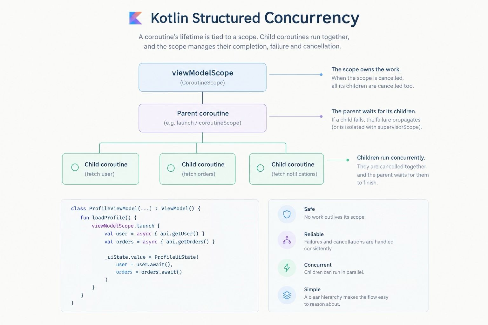

### Structured concurrency is a model for managing concurrent tasks in which the lifetime of a coroutine is tied to a scope, and the scope defines how its child coroutines are managed.

### In Kotlin, structured concurrency is built around CoroutineScope, Job, coroutine builders such as launch and async, and cancellation and exception propagation.

1. CoroutineScope — the owner
Defines the context in which coroutines are launched and establishes the parent relationship for newly launched coroutines.
Example: viewModelScope.

2. Job — the lifecycle
Represents a coroutine's lifecycle. It tracks completion, cancellation, and relationships between parent and child jobs.

3. CoroutineDispatcher — where execution happens
Determines which execution resources run coroutine code, such as Dispatchers.Main, Dispatchers.IO, and Dispatchers.Default.

4. CoroutineContext — the configuration
A collection of context elements, commonly including a Job, a dispatcher, and optional metadata such as a coroutine name.
