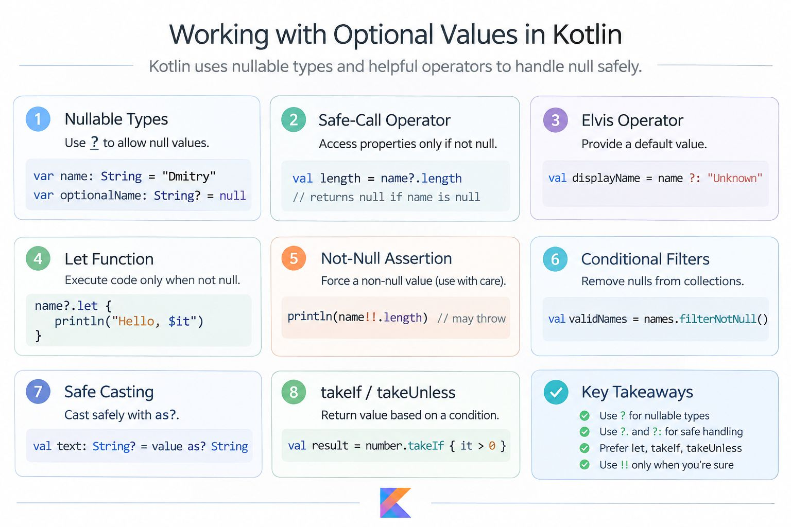

## Kotlin has a built-in null-safety system that makes working with potentially missing values safer and more predictable.

### The most important constructs to understand.

- ? — declare nullable types.
- ?. — safely access properties and methods.
- ?: — provide a default value (Elvis operator).
- ?.let {} — execute logic only when a value is not null.
- !! — force non-null assertion (use carefully).
- filterNotNull() — remove null values from collections.

These features are particularly useful when working with API responses, database entities, and UI state in Jetpack Compose.

### Prefer safe operations over force-unwrapping. Let the type system help prevent unexpected NullPointerExceptions.

