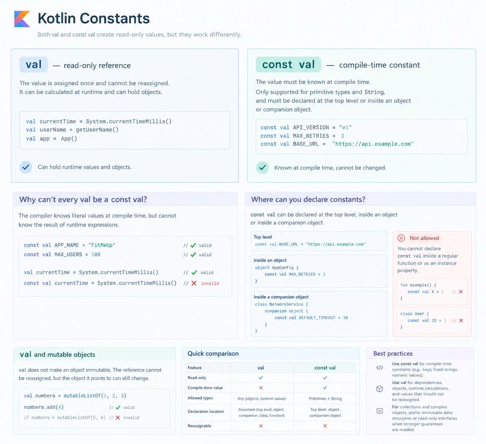

val - read-only reference
The value is assigned once and cannot be reassigned. It can be calculated at runtime.
Can hold runtime values and objects.

const val — compile-time constant
The value must be known at compile time.
Only supported for primitive types and String, and must be declared at the top level or inside an object or companion object.

The compiler knows const val MAX_USERS = 100 before the program runs. It cannot know the result of System.currentTimeMillis() until runtime.
This is why const val is useful for fixed configuration values, keys, and other literal constants.

For the constants allowed top level declaration and inside an object.

Another important Kotlin concept - val does not make an object immutable.

val numbers = listOf(1, 2, 3)
numbers.add(4)        // Valid
numbers = mutableListOf(5, 6) // Invalid

The reference cannot be reassigned, but the object it points to can still change.

Use const val for compile-time constants such as fixed strings and numeric values. Use val for dependencies, objects, runtime calculations, and values that should not be reassigned.

For collections and complex objects, prefer immutable data structures or read-only interfaces when you need stronger guarantees about state.
