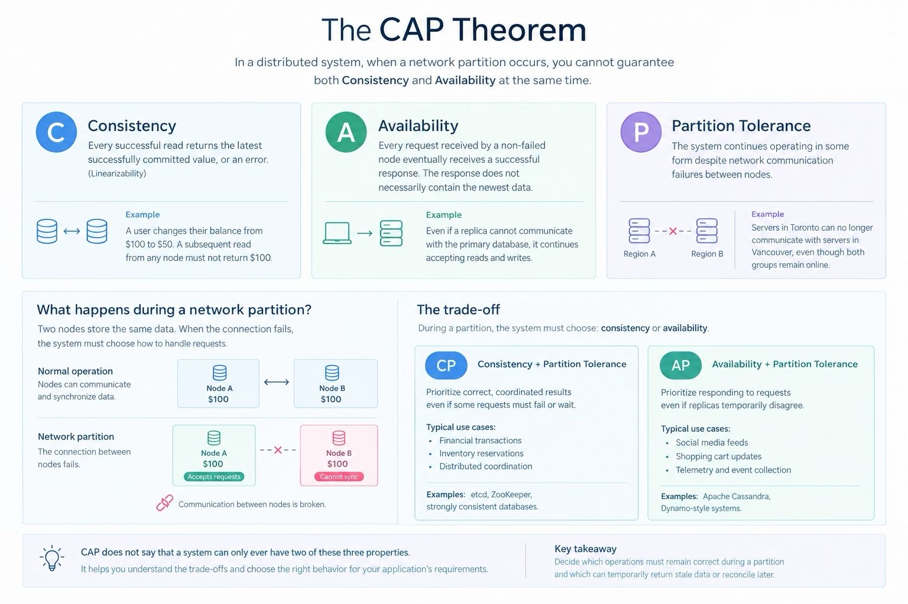

### The CAP theorem states that any distributed data store can simultaneously provide at most two of three core guarantees: Consistency, Availability, and Partition Tolerance.

### How to apply CAP in system design.

1. Identify the data. Is stale data acceptable? A social feed often tolerates it; an account balance generally does not.

2. Define the consistency guarantee. Must every read reflect the latest completed write, or is eventual consistency sufficient?

3. Define failure behavior. Should a request fail or wait when coordination is unavailable, or should the system continue using local data?

4. Choose the replication and coordination strategy. Consider leader-based replication, quorum reads and writes, conflict resolution, and recovery after partitions.

5. Test the failure case. Simulate a lost network connection and verify the behavior of reads, writes, timeouts, and recovery.
