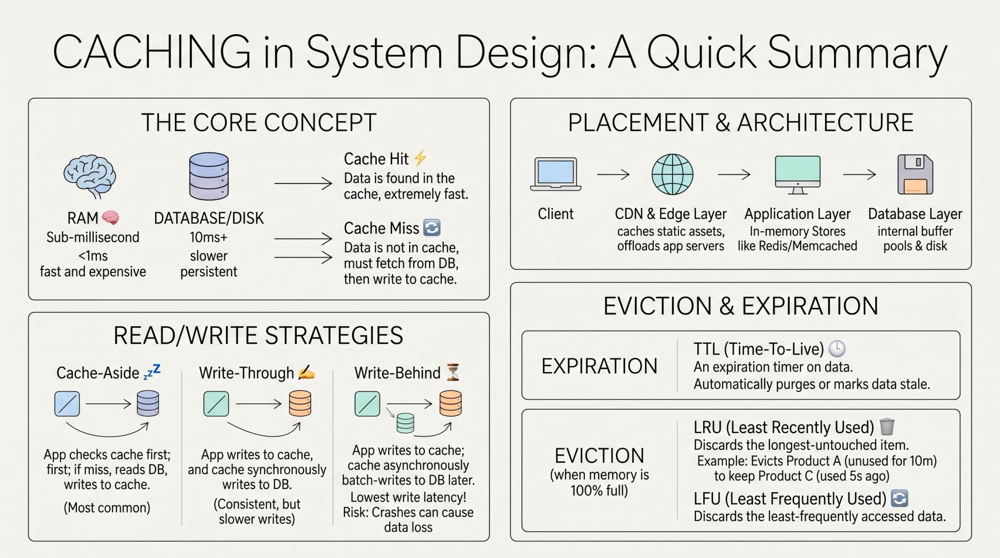

### At its core, caching is the practice of storing copies of data in a high-speed, temporary storage layer-typically in RAM - so future requests can be served much faster than fetching from a primary database or disk. For instance, reading data from an in-memory store like Redis takes sub-milliseconds, whereas querying a disk-backed relational database can easily take 10 to 100+ milliseconds.

1: Cache Placement & Architecture
Caches can live at different layers of an application stack depending on where you want to eliminate latency:
 Client & Edge Layer (CDN): Stores static assets (images, stylesheets, videos) at edge servers physically close to users, cutting down network travel time.
 Application Layer (In-Memory Caches): Uses dedicated memory stores like Redis or Memcached alongside application servers to keep frequently accessed objects and query results in RAM.
 Database Layer: Leverages internal buffer pools within the database management system to keep hot disk pages stored directly in memory.

2: Read/Write Caching Strategies.
 Cache-Aside (Lazy Loading): The app checks the cache first. On a miss, it reads from the DB, writes to the cache, and returns the data.
 Write-Through: The app writes data to the cache, and the cache synchronously writes to the DB before confirming success.
 Write-Behind (Write-Back): The app writes to the cache immediately. The cache then asynchronously batch-writes updates to the DB later.

3: Eviction & Invalidation Policies.
Because RAM is fast but expensive, cache space is strictly limited. To keep caches running smoothly and prevent serving outdated ("stale") data, we rely on two key mechanisms:
 TTL (Time-To-Live): Sets an expiration timer on cached data. Once the timer ends, the data is automatically purged or marked stale.
 Eviction Policies: Determines which data to throw away when the cache memory hits 100% capacity. Common rules include LRU (Least Recently Used) and LFU (Least Frequently Used).
 