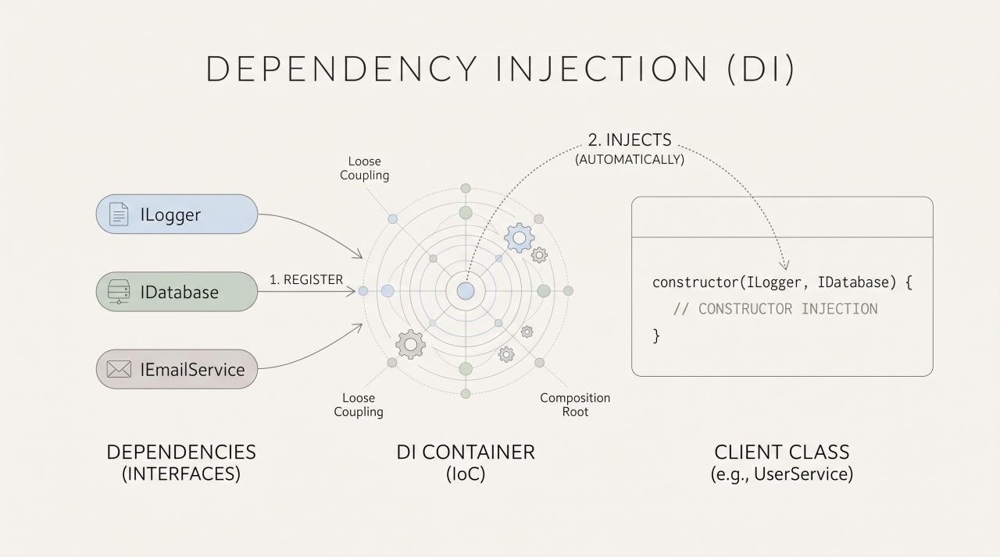

A DI Container automates the creation, wiring, and lifetime management of objects in an application. Instead of manually instantiating classes⁠, the container injects dependent services—typically via constructor injection.

When used correctly, DI containers keep code loosely coupled, highly testable, and modular. However, misusing them can lead to hidden anti-patterns, memory leaks, or tightly coupling your business logic to the framework itself.

Core Architectural Principles.

 Composition Root: Configure and wire your DI container in a single location as close to the application's entry point as possible (e.g., ⁠Program.cs⁠ or ⁠Main⁠).
 Constructor Injection: Pass required dependencies explicitly through a class's constructor. This declares dependencies upfront and guarantees an object cannot be instantiated in an invalid state.
 Avoid Service Locator: Refrain from passing the container itself into your classes to fetch dependencies on demand (e.g., calling ⁠container.GetService<ILogger>()⁠). This anti-pattern hides dependencies, complicates unit testing, and couples business logic directly to the container framework.

 Lifetime Management & Captive Dependencies.
DI containers generally support three main lifetimes to control object creation.

 Transient: A new instance is created every single time it is requested. Best for lightweight, stateless components.
 Scoped: A single instance is created per scope or boundary (most commonly per HTTP request). Ideal for state that should persist only throughout a single operation, like a database session.
 Singleton: One instance is created once and shared across the entire lifespan of the application. Best for stateless caches or expensive thread-safe services.
 