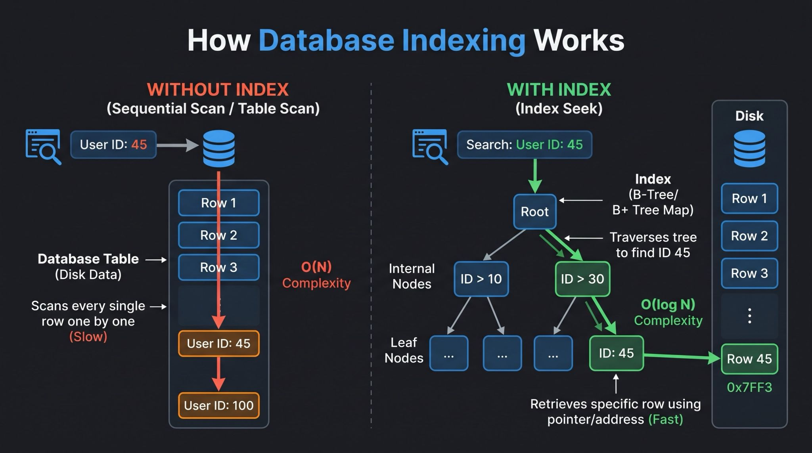

# Database Indexing
Indexing is a performance optimization technique that creates a separate, specialized data structure (the "index") to allow a database to locate and retrieve specific rows of data instantly without having to scan the entire table.

### Why?
When a database grows to millions or billions of rows, scanning every single row to find a matching record (a sequential/full table scan) takes too much time ($O(N)$ time complexity) and burns massive CPU and I/O resources.Drastic Performance Gains: It transforms slow, resource-heavy searches into near-instant lookups (reducing complexity from $O(N)$ to $O(\log N)$ or $O(1)$).Scaling Read Heavy Workloads: Fast queries mean your database can handle thousands of concurrent read requests without choking.Sorted Results: Indexes inherently keep data in a structured/sorted order, which also speeds up sort (ORDER BY), grouping (GROUP BY), and range filtering (BETWEEN, >, <) operations.

### Under the Hood
- The Core Data Structure (The B-Tree): Under the hood, databases (like PostgreSQL, MySQL) typically use a B-Tree or B+ Tree structure for indexing. The tree is made up of nodes: Root (the starting point), Internal Nodes (the signposts), and Leaf Nodes (the final destinations).Key-Pointer 
- Mapping: A B-Tree index contains only two pieces of information: the Index Key (e.g., user_id) and a Pointer to the physical location on disk where the actual row of data lives (the RowID or File Offset).
- The Seek Journey: When you execute a search, the database engine checks the Root of the Index B-Tree. It compares the target value to the values in the root to choose which child branch to take (e.g., "Go right because User ID 45 is > 30").
- Down the Nodes: It traverses the Internal Nodes, making fast, binary-like decision trees, navigating directly down to the target Leaf Node.Disk Retrieval (Pointer Resolution): Upon reaching the Leaf Node for ID 45, the engine reads the stored pointer/address (e.g., 0x7FF3). It skips scanning any other data on the drive, jump-cutting straight to the block of disk memory hosting Row 45 and retrieving the full record.4. Example — Real CodeTo use indexing, we apply it to a specific column that is frequently queried.
- Without an Index:
The database must look through every entry to find "Alice".SQL-- Creating a standard table

```SQL
CREATE TABLE users (
    id INT PRIMARY KEY,
    name VARCHAR(100),
    email VARCHAR(100)
);

-- Selecting by email
SELECT * FROM users WHERE email = 'alice@example.com';
-- Result: The database must check every single row (Sequential Scan).
With an Index:We create an index on the email column:SQL-- Create an index on the 'email' column of the 'users' table
CREATE INDEX idx_users_email ON users(email);

-- Selecting by email again
SELECT * FROM users WHERE email = 'alice@example.com';
-- Result: The database does an "Index Seek" on 'idx_users_email', 
-- finding the row almost instantly.
If we run an analysis query to view the difference:SQLEXPLAIN ANALYZE SELECT * FROM users WHERE email = 'alice@example.com';

-- OUTPUT BEFORE INDEX: "Seq Scan on users  (cost=0.00..35.40 rows=1 width=36) (actual time=12.422..12.422 loops=1)"
-- OUTPUT AFTER INDEX: "Index Scan using idx_users_email on users (cost=0.15..8.17 rows=1 width=36) (actual time=0.012..0.013 loops=1)"
```

### Trade-offs and Pitfalls
While indexes make reads lightning-fast, they are not free:The Write Penalty (Performance overhead): Every time you insert (INSERT), delete (DELETE), or modify (UPDATE) a row, the database must write the data to the table and rearrange/balance the index B-Tree. More indexes = slower write operations.Storage Cost (Disk bloat): Indexes need to be stored on disk and loaded into RAM to be effective. For gigantic tables, index sizes can exceed the size of the original data.Index Fragmentation: Frequent edits can create gaps and disjointed leaves in the B-Tree, requiring maintenance (REINDEX / OPTIMIZE) over time.Over-indexing: Creating indexes on too many columns, or columns with low diversity of data (low cardinality, e.g., a "gender" or "status" column with few unique values), might confuse the query optimizer and will waste memory.       

### Interview Question:
"Can you explain how indexing improves database search speeds, and when you shouldn't use them?         
Response:"At its core, indexing is like a book's index: instead of flipping through every page of a table to find a row—which is a slow $O(N)$ sequential scan—the database uses a separate, balanced tree structure like a B-Tree to navigate directly to the physical disk location of that row in $O(\log N)$ time.When you query a column like user_id or email, the index allows the database to traverse nodes and resolve the exact pointer/address of the record, converting a full-table scan into an instant search.However, we shouldn't use indexes blindly because of two major catches:Write Amplification: Every insertion, deletion, or update forces the database to re-balance the tree, which slows down write/ingest heavy workflows.Storage and RAM: Indexes consume significant space and must live in memory for optimal speed.Best practice is to selectively index columns that are heavily queried in WHERE clauses, JOIN conditions, or ORDER BY operations, while avoiding indexing columns with low variance (low cardinality) or on tables with heavily dominant write patterns."

