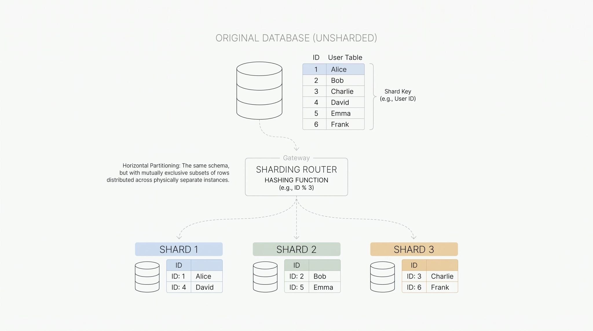

# Database Sharding

Database sharding is the horizontal partitioning of a single logical dataset across multiple independent physical database instances (shards), where every shard shares the identical schema but stores a mutually exclusive subset of rows.
### Why It Matters
Vertical Scaling Ceilings: Upgrading a single server's CPU, RAM, and NVMe storage hits physical hardware limits and exponential cost curves.
Write Bottlenecks: Read replicas only scale SELECT queries. Every replica must still replay the entire Write-Ahead Log (WAL), so adding replicas does nothing to relieve INSERT, UPDATE, or DELETE saturation on the primary node.
Memory & Index Thrashing: When table indexes exceed a single machine's available RAM, B-tree lookups spill onto disk, causing severe p99 latency spikes.
Linear Capacity Growth: Sharding partitions write IOPS, lock contention, storage footprint, and working-set memory across 
N
N independent machines.

### Under the Hood
- Shard Key Selection: Every sharded table designates a partition column (e.g., tenant_id or user_id). The shard key must have high cardinality and uniform access distribution so rows spread evenly across nodes.
Partitioning Strategy: A deterministic routing function maps each shard key to a target shard:
- Range-Based: Assigns contiguous key intervals to specific shards (e.g., user_id 1–1,000,000 → Shard 1). Enables fast range scans, but sequential IDs or timestamps concentrate all new writes onto a single tail shard.
Hash-Based (Modulo): Computes hash(shard_key) % N. Distributes writes uniformly, but changing 
N
N (adding or removing nodes) remaps nearly every key, forcing massive data migration.
Consistent Hashing: Maps both shard keys and physical shards (represented via multiple virtual nodes) onto a circular hash ring (
0 0 to 2 32 − 1 2 32 −1). Keys route clockwise to the nearest virtual node; adding a shard only moves 1 / N 1/N of existing keys.

- Directory-Based: Maintains a dedicated lookup table mapping specific keys to physical shard addresses. Allows granular placement, but adds a network hop and makes the lookup store a critical dependency.
Query Routing: Incoming queries hit an application-level routing library or a middleware proxy (e.g., Vitess, Citus, mongos). The router parses the query, extracts the shard key predicate, and selects the corresponding database connection pool.

- Execution & Aggregation:
Targeted (Single-Shard) Query: If the query filter includes the shard key, the router forwards it directly to one shard. Latency equals single-node execution plus minimal proxy overhead.
Scatter-Gather Query: If the shard key is omitted, the router broadcasts the query to all N N shards concurrently, buffers all responses in memory, merges/sorts the results (ORDER BY, LIMIT, COUNT), and returns the combined payload. Response time is bounded by the slowest shard.

```Python
import bisect
import hashlib
from concurrent.futures import ThreadPoolExecutor
from typing import Any


class ConsistentHashShardRouter:
    def __init__(self, shard_connections: dict[str, Any], virtual_nodes: int = 100):
        self.shards = shard_connections
        self.virtual_nodes = virtual_nodes
        self.ring: list[int] = []
        self.vnode_to_shard: dict[int, str] = {}

        for shard_id in self.shards:
            for i in range(self.virtual_nodes):
                vnode_hash = self._hash(f"{shard_id}#vnode{i}")
                self.ring.append(vnode_hash)
                self.vnode_to_shard[vnode_hash] = shard_id

        self.ring.sort()

    @staticmethod
    def _hash(key: str) -> int:
        return int(hashlib.md5(key.encode("utf-8")).hexdigest(), 16)

    def get_shard_id(self, shard_key: str) -> str:
        key_hash = self._hash(shard_key)
        idx = bisect.bisect_right(self.ring, key_hash)
        if idx == len(self.ring):
            idx = 0
        return self.vnode_to_shard[self.ring[idx]]

    def execute_targeted(self, shard_key: str, query: str, params: tuple = ()) -> Any:
        """O(log V) routing to a single shard when shard_key is known."""
        target_id = self.get_shard_id(shard_key)
        conn = self.shards[target_id]
        return conn.execute(query, params)

    def execute_scatter_gather(self, query: str, params: tuple = ()) -> list[Any]:
        """Broadcasts query across all shards when shard_key is absent."""
        results = []
        with ThreadPoolExecutor(max_workers=len(self.shards)) as pool:
            futures = [
                pool.submit(conn.execute, query, params)
                for conn in self.shards.values()
            ]
            for future in futures:
                results.extend(future.result())
        return results
```

### Trade-offs and Pitfalls
No Native Cross-Shard Joins: Relational JOIN operations and foreign-key constraints cannot span physically separate database instances. Joins must be executed in application memory via multiple network round-trips, or avoided through data denormalization.
Expensive Distributed Transactions: Atomic writes across multiple shards require Two-Phase Commit (2PC) or asynchronous Saga workflows. 2PC holds locks across network boundaries and severely degrades throughput; Sagas introduce eventual consistency and compensation logic.
Hotspots (Data and Traffic Skew): Selecting a low-cardinality or skewed shard key (such as an enterprise tenant generating 100x average traffic, or a celebrity user ID) overloads one shard's CPU and disk I/O while sibling shards remain idle.
Resharding & Operational Complexity: Schema changes (ALTER TABLE), backups, and point-in-time recovery must be coordinated across N N clusters. Splitting an overloaded shard requires dual-writing, background data backfills, and checksum verification before cutting over traffic.



### Interview Answer
Likely Question:
"Our primary PostgreSQL database is hitting 95% write CPU and 8 TB of storage, and adding read replicas no longer reduces latency. How do you scale it, and what breaks once you do?"
60-Second Answer:
"Read replicas aren't helping because every replica still has to replay the full write-ahead log, so write saturation on the primary remains the bottleneck. At 8 TB and 95% write CPU, we need to scale horizontally via database sharding.

First, I'd audit our query patterns to pick a high-cardinality shard key—like tenant_id or user_id—that appears in the WHERE clause of our most frequent queries so requests route to a single shard. I'd pair that with consistent hashing using virtual nodes behind a routing layer like Citus or Vitess so we can rebalance capacity later without moving the entire dataset.

Introducing sharding breaks three relational guarantees: native cross-shard joins, cross-shard foreign keys, and single-node ACID transactions. To handle that, we co-locate child tables by the same shard key, denormalize read-heavy lookup data, replace distributed transactions with idempotent Sagas where possible, and enforce strict limits on scatter-gather queries so a single unindexed query doesn't fan out across every shard."