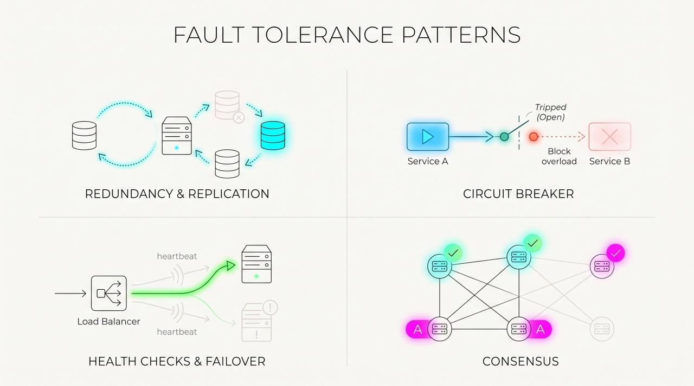

### In large-scale system design, failures are considered an absolute certainty rather than a rare exception. Instead of trying to prevent every possible failure, fault-tolerant architectures are built to automatically detect, isolate, and recover from components crashing without degrading the experience for the end user.

### Fault tolerance is a system's ability to remain operational and continue serving requests even when individual components—such as hardware servers, network links, or database nodes - fail unexpectedly.

### Essential patterns.
- Redundancy & Data Replication: Running duplicate instances of services or keeping multiple copies of databases. If one node crashes, a replica takes over without losing data.

- Circuit Breaker: Similar to a physical electrical breaker, this pattern temporarily blocks requests to a failing service. This stops cascading failures from spreading across the system and gives the failing service room to recover.

- Health Checks & Failover: Load balancers continuously monitor service health. When a node fails a health check, traffic is automatically rerouted to healthy nodes.

- Consensus Algorithms: Protocols like Raft or Paxos that allow distributed nodes to agree on a single state, even when network partitions or server crashes occur.
