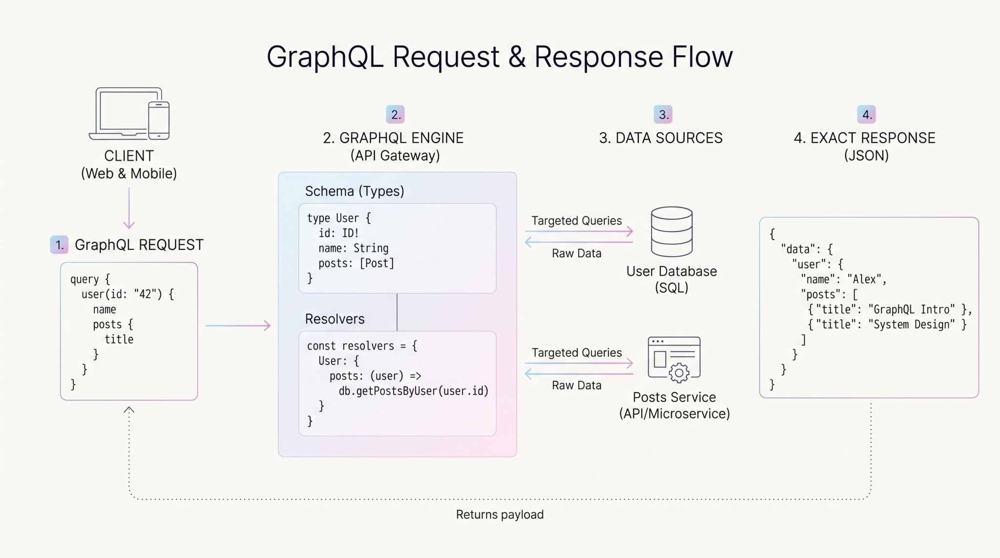

A GraphQL server acts as an orchestration layer between client applications (web, mobile) and underlying microservices or databases. While it eliminates over-fetching and reduces client round-trips, it introduces distinct system design trade-offs—such as the infamous N+1 query execution problem, server-side caching complexities, and query safety risks (like recursive or deeply nested query attacks).

The Execution Pipeline.
1. Parsing: The server receives a query string and parses it into an Abstract Syntax Tree (AST).
2. Validation: The AST is validated against the Schema Definition Language (SDL) to ensure requested fields, types, and arguments exist.
3. Execution & Resolvers: The execution engine traverses the AST. For each requested field, it calls a Resolver Function to retrieve data from a database, cache, or downstream service.

Because GraphQL resolvers run independently for every node in the query tree, nested queries can degrade database performance, this is called the N+1 problem.

Facebook introduced DataLoader. It operates as a utility layer between resolvers and databases and fix the problem without giving up GraphQL's flexibility.
