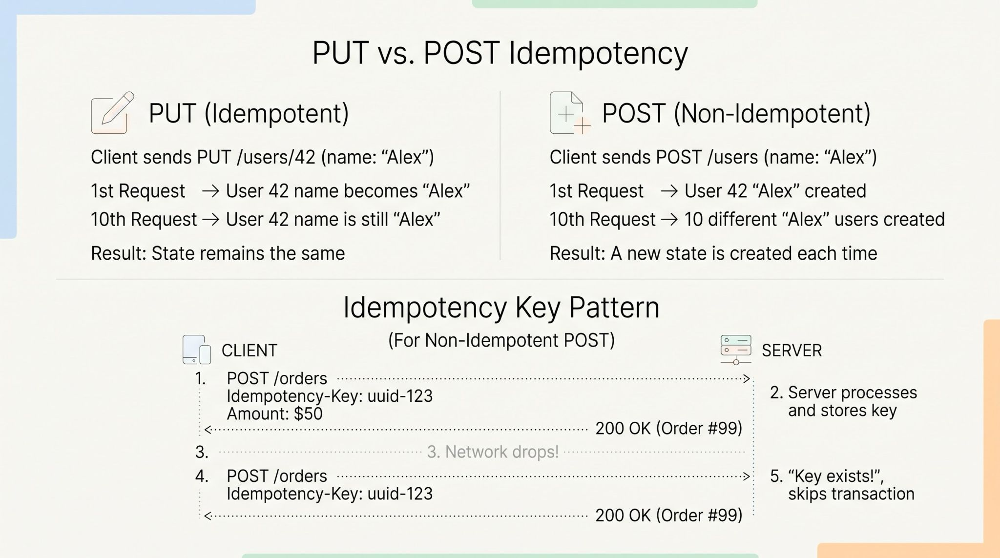

Safe Methods: Methods that do not modify state on the server at all (read-only). All safe methods are naturally idempotent.

Idempotent Methods: Methods where multiple identical requests leave the server in the exact same final state as a single request (even if they modify state).

POST /users⁠: "Create a new user named 'Alex'." If you execute this 5 times, you create 5 distinct user records with 5 unique IDs.

A ⁠PUT⁠ method is idempotent because it replaces a resource entirely or creates it at a specific URI so multiple identical requests leave the system unchanged, whereas a ⁠POST⁠ method is non-idempotent because it submits data to let the server determine the resource's identity, meaning multiple identical requests can create multiple different records or trigger repeated actions.
