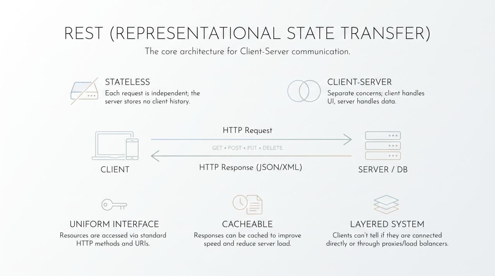

# REST (Representational State Transfer) is an architectural style for designing distributed systems. It defines constraints for web services, dictating how components communicate.

### Core Constraints
###  Statelessness: The server retains no client state between requests. Every request must contain all data necessary for execution. This enables immediate horizontal scaling.

### Client-Server: Strict separation. The client manages UI; the server manages data and business logic. They evolve independently.

### Uniform Interface: Resources are exposed via specific URIs. Standard HTTP methods execute operations: GET (retrieve), POST (create), PUT/PATCH (update), DELETE (remove).

### Cacheability: Server responses explicitly state if and how long data can be cached. This reduces server load and network latency.

### Layered System: Clients cannot distinguish whether they are connected to the end server or an intermediary (load balancers, reverse proxies). This allows transparent architecture changes.
 