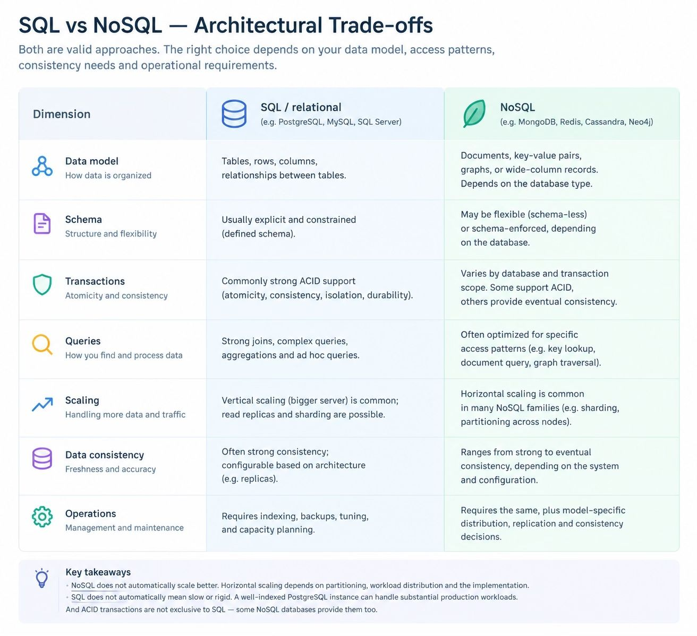

### SQL and NoSQL are two broad approaches to storing and retrieving data. The architectural decision is not simply about which database is faster. It is about how your data is structured, how your application accesses it, and what consistency, scalability, and operational trade-offs you need.

### A practical default is to start with a relational database unless your requirements indicate a specific advantage from another data model. It is usually easier to begin with a well-designed PostgreSQL database than to introduce multiple database technologies before they are necessary.

### How to choose a database in system design?

1. Define access patterns
What data will the application read, write, filter, join, and aggregate?
2. Define consistency requirements
Must related updates succeed or fail together? Can data be temporarily stale?
3. Estimate workload
Data volume, read/write ratio, query complexity, throughput, latency, and growth.
4. Select and validate
Choose a data model, design indexes, test representative workloads, and measure bottlenecks.

### Choosing SQL or NoSQL is only one part of the design. You also need to understand the scaling options.

1. Vertical scaling
Increase CPU, RAM, or storage on one database server. This is often the simplest first step, but has hardware and cost limits.
2. Read replicas
Send writes to a primary and distribute eligible reads across replicas. Replication lag can cause stale reads, and replicas do not automatically solve write bottlenecks.
3. Sharding / partitioning across nodes
Split data by a key, such as tenant ID or user ID. This can increase capacity, but adds complexity around query routing, cross-shard transactions, and rebalancing.
