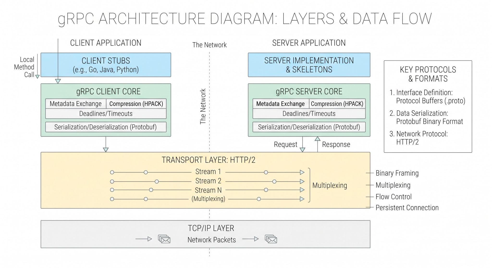

# gRPC (gRPC Remote Procedure Calls)
gRPC is an open-source, high-performance Remote Procedure Call framework developed by Google that operates over HTTP/2, utilizes Protocol Buffers as its interface definition language, and enables client and server applications to communicate transparently across distributed environments.      

## Why it Matters.
Traditional REST architectures rely on JSON payloads over HTTP/1.1, introducing high CPU overhead for text parsing, massive payload sizes, and connection-level head-of-line blocking. gRPC solves these performance bottlenecks by serializing data into compact binary formats and leveraging HTTP/2 multiplexing, reducing payload sizes by up to 10x and increasing throughput by up to 8x. It provides strongly typed contracts, built-in bidirectional streaming, and automatic code generation across multiple languages, making it the definitive standard for internal microservice-to-microservice communication and high-frequency, low-latency systems.          

## How it Works.
- Interface Definition (.proto): Services, method signatures, and data payloads are defined explicitly in Protocol Buffer schema files (.proto).
- Stub Generation: The Protocol Buffers compiler (protoc) compiles .proto files into native client and server code stubs for target languages (e.g., Go, Java, Python, C++, TypeScript).
- Serialization: When a client invokes a remote method, the client-side stub serializes structured data objects into a compact binary format using Protocol Buffers (tag-length-value encoding), eliminating text-parsing overhead.
- Transport Layer (HTTP/2): The binary payload is transmitted over an HTTP/2 connection. HTTP/2 allows multiple concurrent request/response streams to run over a single persistent TCP connection, bypassing HTTP/1.1 connection exhaustion.
- HPACK Compression: Metadata (HTTP headers) is compressed using HPACK algorithms to minimize wire overhead.
- Execution and Deserialization: The server stub receives the binary stream, deserializes the bytes into native objects, executes the business logic, and returns the response bytes through the same bi-directional pipe.

### service.proto
```proto
syntax = "proto3";

package user;

service UserService {
  rpc GetUser (UserRequest) returns (UserResponse);
}

message UserRequest {
  string user_id = 1;
}

message UserResponse {
  string user_id = 1;
  string name = 2;
  string email = 3;
}
```

### server.go
```go
package main

import (
	context "context"
	"fmt"
	"net"

	"google.golang.org/grpc"
	pb "path/to/your/generated/proto"
)

type server struct {
	pb.UnimplementedUserServiceServer
}

func (s *server) GetUser(ctx context.Context, req *pb.UserRequest) (*pb.UserResponse, error) {
	return &pb.UserResponse{
		UserId: req.UserId,
		Name:   "Jane Doe",
		Email:  "jane.doe@example.com",
	}, nil
}

func main() {
	lis, err := net.Listen("tcp", ":50051")
	if err != nil {
		panic(err)
	}
	s := grpc.NewServer()
	pb.RegisterUserServiceServer(s, &server{})
	fmt.Println("gRPC server listening on :50051")
	if err := s.Serve(lis); err != nil {
		panic(err)
	}
}
```

### client.go
```go
package main

import (
	context "context"
	"fmt"
	"time"

	"google.golang.org/grpc"
	"google.golang.org/grpc/credentials/insecure"
	pb "path/to/your/generated/proto"
)

func main() {
	conn, err := grpc.Dial("localhost:50051", grpc.WithTransportCredentials(insecure.NewCredentials()))
	if err != nil {
		panic(err)
	}
	defer conn.Close()

	client := pb.NewUserServiceClient(conn)
	ctx, cancel := context.WithTimeout(context.Background(), time.Second)
	defer cancel()

	res, err := client.GetUser(ctx, &pb.UserRequest{UserId: "123"})
	if err != nil {
		panic(err)
	}
	fmt.Printf("User: %s (%s)\n", res.Name, res.Email)
}
``` 




### Trade-offs and Pitfalls.
- Human Readability: Protocol Buffers are binary-encoded. Inspecting raw network payloads requires specialized tooling (grpcurl, Wireshark) rather than standard text-based HTTP inspection.
- Browser Support: Native gRPC cannot run directly in standard web browsers due to missing low-level HTTP/2 frame access. Deploying to frontend clients requires a proxy layer (gRPC-Web).
- Schema Evolution Complexity: Strict contractual definitions require rigid versioning discipline. Modifying or deleting fields in .proto files without following backward-compatibility rules (e.g., reusing field numbers) corrupts data serialization.
- Load Balancing Overhead: Because HTTP/2 multiplexes multiple RPC streams over a single persistent TCP connection, standard Layer 4 round-robin load balancers balance connections rather than requests, necessitating Layer 7 proxies like Envoy.

### Interview Answer — Likely Question
Likely Question: "What is gRPC, why do you choose it over REST, and how does it achieve its performance gains?"        
60-Second Answer:         
"gRPC is a high-performance RPC framework operating over HTTP/2 that uses Protocol Buffers for interface definition and binary serialization. I choose it over REST for internal microservices because it offers vastly superior speed, lower CPU overhead, and native bidirectional streaming. Unlike REST, which serializes data into human-readable JSON over HTTP/1.1 and suffers from text-parsing overhead and connection-level head-of-line blocking, gRPC serializes payloads into compact binary byte streams and multiplexes numerous concurrent requests over a single TCP connection via HTTP/2. Additionally, gRPC enforces strict API contracts through .proto files, eliminating documentation drift and automatically generating type-safe client and server stubs across multiple languages."