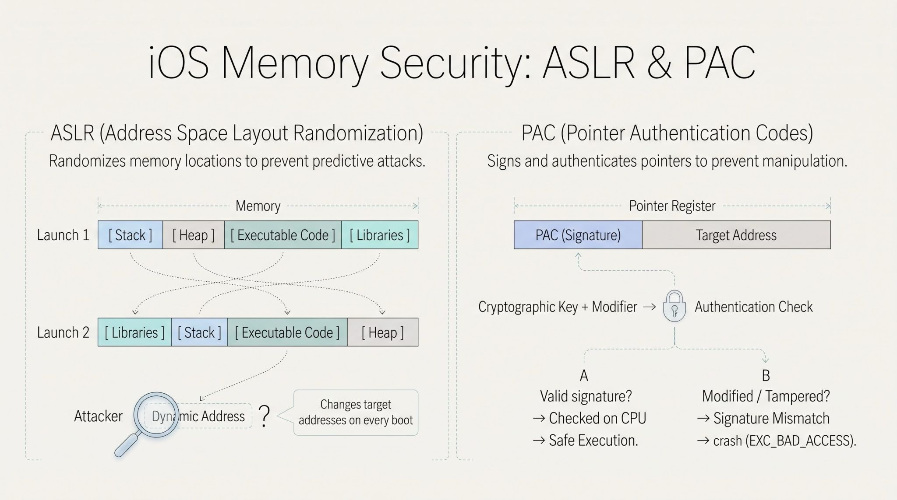

ASLR and PAC are two complementary memory protection mechanisms in iOS designed to block exploits from executing arbitrary code.

ASLR (Address Space Layout Randomization): Randomizes the locations of key memory regions (executable code, stack, heap, and libraries) in process memory each time an application or kernel boots. This is why raw memory addresses in crash logs change every time.

PAC (Pointer Authentication Codes): An ARMv8.3-A hardware-level mitigation introduced in Apple A12 processors and newer. PAC uses cryptographic signatures stored in the unused bits of a 64-bit pointer. Before a pointer (like a return address or function pointer) is used, the CPU authenticates the signature using secret keys. If tampered with, the signature check fails and immediately halts execution.

Security scanners routinely check whether an app binary has Position-Independent Executable (PIE, which enables ASLR) and arm64e PAC support enabled.
