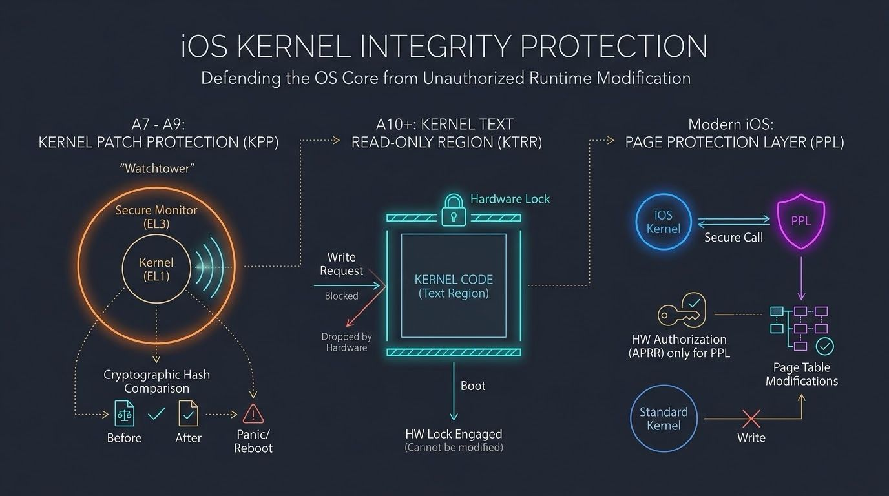

iOS Kernel Integrity Protection safeguards the operating system core against runtime memory modifications. When a localized exploit grants read/write access to kernel memory, this protection prevents the permanent alteration of kernel code and critical system data structures.

The mechanism relies on hardware-software integration and evolved across chip generations. 

Kernel Patch Protection (KPP / Watchtower) – A7 to A9 Processors
KPP operates in the Secure Monitor (Exception Level 3), a higher privilege state than the kernel (Exception Level 1). KPP asynchronously and unpredictably halts all CPU cores. It scans the kernel's memory space, calculating cryptographic hashes of the kernel text (code) and read-only data structures. It compares these against baseline hashes generated during boot. If the memory is altered, KPP triggers a system panic and forces a reboot.

Kernel Text Read-Only Region (KTRR) – A10 Processors and Newer
KTRR replaces periodic checking with strict hardware enforcement. During boot, the system configures the memory controller to designate the kernel code region as read-only. Once set, a hardware lock is engaged. The memory controller will physically drop any write requests to this region, even if the request originates from the kernel itself. The configuration registers cannot be modified until a hard hardware reset.

Page Protection Layer (PPL) and APRR/CTRR – Modern iOS
To protect dynamic page tables, Apple introduced PPL. PPL executes in a protected execution environment. The standard iOS kernel is stripped of its ability to modify its own page tables. If the kernel needs to allocate memory or change permissions, it must issue a secure call to PPL. PPL verifies the request against a strict security policy. Hardware extensions (APRR) ensure that only code executing from the specific PPL memory region possesses the hardware authorization to write to the page tables.
