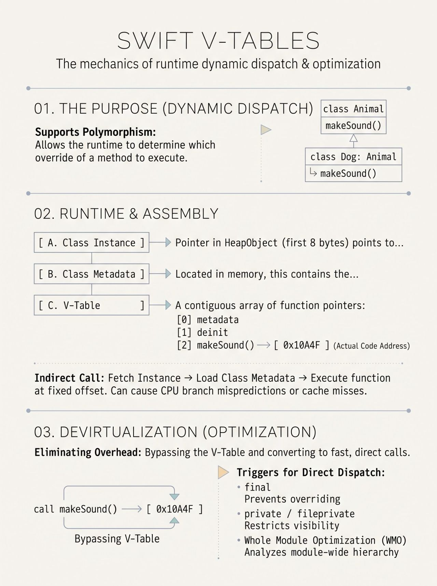

Virtual Method Table. v-table is a contiguous memory array of function pointers associated with a class type. Its purpose is to support dynamic dispatch that allowes the Swift runtime to determine which specific subclass method to call when overridden methods are invoked through polymorphism.

Here is what happens at a high level:
 Compile Time: The Swift compiler inspects class hierarchies and builds a fixed v-table for each class, assigning every overrideable method a specific index (offset).
 Runtime: Every instance of a class contains a pointer to its class metadata. When a method is called, Swift reads the class metadata, locates the method pointer using its index in the v-table, and jumps to that memory address.

Each Swift class instance begins with a standard header (⁠HeapObject⁠).
 Instance Header: The first 8 bytes (on 64-bit architecture) of any class instance store a pointer to its Class Metadata.
 V-Table Location: Inside the metadata structure, at a fixed offset, sits the v-table—a sequential array of function pointers.
 Assembly Execution: When calling an overridable method like ⁠animal.makeSound()⁠, the compiled assembly performs three steps:
1. Fetch Instance: Loads the object address into a CPU register.
2. Fetch Metadata: Dereferences the object pointer to locate its class metadata.
3. Indirect Call: Adds the method's fixed index offset to load the function pointer, then executes an indirect ⁠call⁠ to that memory address.
Because subclasses inherit the exact v-table layout of their parent class (just append new methods at the end), the offset for ⁠the method remains identical across all subclasses.

To avoid these CPU stalls, the Swift compiler attempts Devirtualization. Convert indirect v-table dispatch into fast direct calls (or even inlining the method body entirely) whenever it can prove an override is impossible.

Here is how devirtualization is achieved:
 final⁠ keyword: Explicitly guarantees a class or method cannot be overridden, entirely bypassing the v-table.
 private⁠ / ⁠fileprivate⁠ access control: Restricts visibility to a single file. The compiler inspects the file, and if no subclass overrides the method, it automatically devirtualizes the call.
 Whole Module Optimization (WMO): Normally, Swift compiles files independently, so it must assume a method might be overridden in another file. WMO compiles the entire module together, allowing the compiler to verify class hierarchies across all files and eliminate v-table lookups wherever possible.

