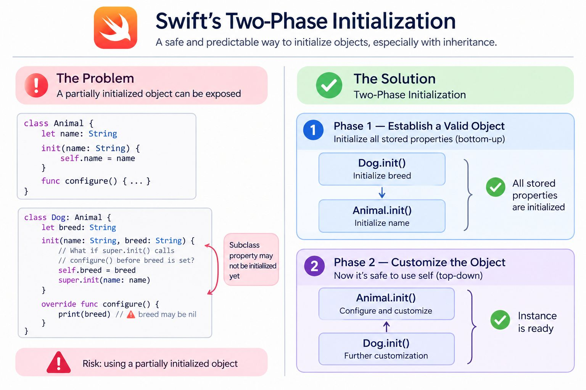

Swift's Two-Phase Initialization exists to guarantee that an object is fully initialized and safe to use before it becomes accessible to other parts of the program.

There are three underlying design principles.

Memory safety.
Swift doesn't allow an object to be used while its stored properties are uninitialized.

Inheritance safety.
A superclass can execute code that dynamically dispatches to subclass overrides. Therefore, the subclass must already have valid stored properties.

Predictable initialization.
Each class is responsible for initializing the properties it introduces. A superclass cannot accidentally overwrite values that a subclass assigns before superclass initialization.
