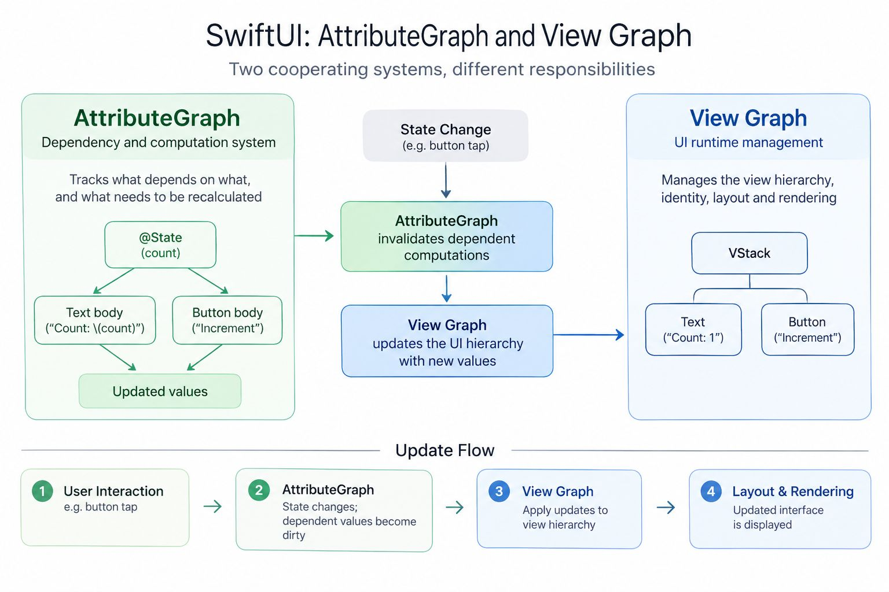

AttributeGraph manages dependencies and data updates, while ViewGraph manages the structure and lifecycle of SwiftUI's rendered interface.

AttributeGraph is an internal framework used by SwiftUI to represent values and their dependencies as a graph.
Instead of treating a SwiftUI interface as a collection of independent views, SwiftUI tracks relationships between values.

Whet state changes.
1. The state attribute is invalidated.
2. Dependent computations become dirty.
3. SwiftUI evaluates the necessary dependent values again.
4. Updated values become available to the rendering system.

View Graph is the runtime structure SwiftUI uses to manage the interface.
SwiftUI views are lightweight value types. They can be recreated frequently. The runtime maintains longer-lived structures to preserve identity, state, and the information needed to update and render the interface.

The View Graph is involved in managing aspects such as:
- View identity and lifetime.
- Insertion and removal of views.
- Layout and geometry.
- Rendering-related information.
- Platform integration.
- Animations and transactions.

AttributeGraph is not simply a dependency graph sitting outside View Graph.
Apple's internal implementation is private, and these concepts overlap. AttributeGraph attributes can represent much more than state variables: view bodies, environment values, styling, and rendering-related computations.
Similarly, View Graph should not be understood as a simple tree of View structs.
