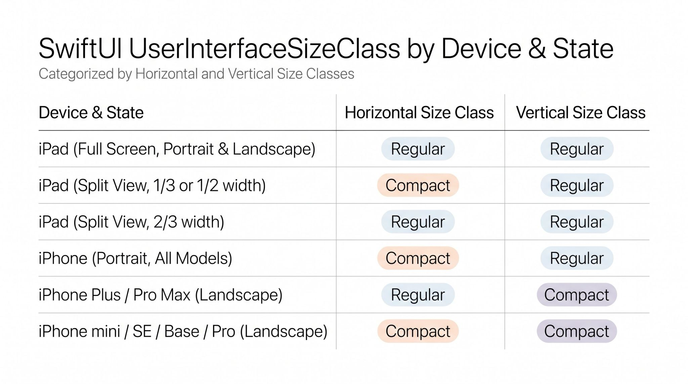

## SwiftUI UserInterfaceSizeClass contains two values: compact and regular. These values combine horizontally and vertically based on the device, screen size, and orientation.

On standard-sized iPhones (like the base or Pro models), rotating to landscape changes the vertical size class to compact, while the horizontal size class stays compact.

Only larger Plus-sized and Max-sized iPhones switch to a regular horizontal size class when turned into landscape mode.

In landscape on an iPhone, monitor @Environment(\.verticalSizeClass) turning into .compact to detect when the phone is sideways.
