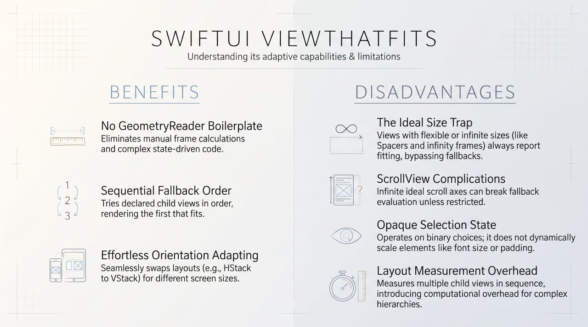

### ViewThatFits benefits and disadvantages.

Benefits
 Eliminates ⁠GeometryReader⁠ boilerplate: Replaces manual frame measurement logic and state-driven conditional layouts with declarative fallbacks.

 Sequential layout selection: Evaluates child views in declared top-to-bottom order and renders the first child that fits within proposed bounds along specified axes (⁠.horizontal⁠, ⁠.vertical⁠, or both).

 Responsive orientation and screen adaptation: Simplifies layout axis switching across varying viewport sizes (e.g., rendering an ⁠HStack⁠ on iPad/landscape and falling back to a ⁠VStack⁠ on iPhone/portrait).

Disadvantages
 Ideal size evaluation trap: Evaluates views based on their ideal size. Views with flexible or unbounded ideal sizes (e.g., ⁠Spacer⁠, ⁠Color⁠, or views using ⁠frame(maxWidth: .infinity)⁠) always report fitting, causing subsequent fallback views to be ignored.

 ⁠ScrollView⁠ edge case: A ⁠ScrollView⁠ has an infinite ideal size along its scroll axis, which can prevent it from fitting or cause unexpected selection behavior unless explicitly constrained.

 Binary layout switching: Operates strictly on an all-or-nothing basis; it does not dynamically scale elements like font sizes, padding, or spacing.

 Opaque selection state: Does not natively communicate which child view was selected to the parent view state, requiring manual ⁠PreferenceKey⁠ implementations if selection tracking is needed.

 Layout measurement overhead: Requires measuring the ideal size of child views in sequence during the layout pass, introducing computational overhead for complex or deeply nested view hierarchies.
 