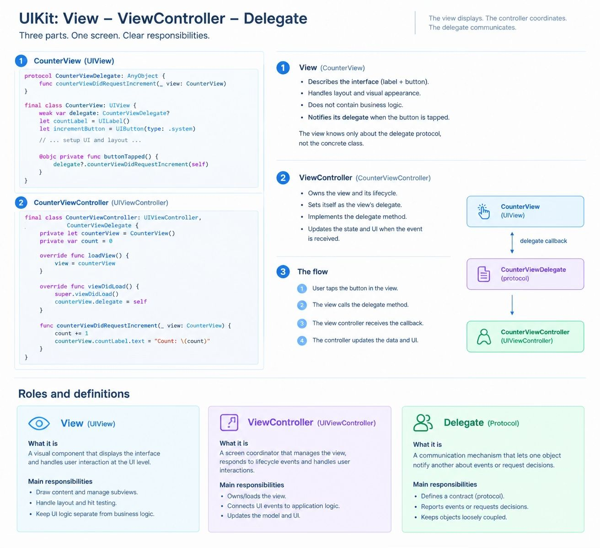

### In UIKit, the relationship between UIView, UIViewController, and delegates is built around one central idea: separate displaying the interface, controlling the screen, and communicating events.
### Once you understand these responsibilities, UIKit becomes easier to reason about because you can predict where code belongs and how objects communicate.

## 1. UIView — the visual component
A view represents a part of the interface: a button, label, text field, or an entire screen's visual layout. It draws content, arranges subviews, and participates in hit testing.
It generally should not decide what the application does when a user taps a button.

## 2. UIViewController — the screen coordinator
A view controller manages a screen or a portion of a screen. It coordinates the view hierarchy, responds to lifecycle events, handles user interactions, and communicates with models or services.
It owns or manages the screen's root view and usually connects UI events to application behavior.

## 3. Delegate — a communication mechanism
A delegate is an object that another object asks to handle certain events or decisions. The relationship is usually defined by a Swift protocol.
For example, a text field reports editing events to its delegate, and a table view asks its data source for rows. A delegate is not necessarily a view controller.

### A delegate does not have to be a view controller. A view controller can delegate work to another object, and a custom view can use a delegate to notify its owner.
### Use target-action for straightforward control events, such as a button tap. Use a delegate when an object needs to report a set of events or decisions through a defined protocol. Use closures when a simple callback is sufficient.
### The central principle is that an object should communicate through a clearly defined interface rather than needing to know the internal implementation of the object receiving its message.
